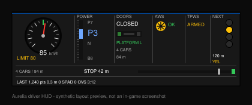

# Driving and signalling

Two things landed together: lineside signal aspects now follow the blocks ahead, and a driver gets a UK-style cab
with AWS and TPWS. Everything visible is switched on the panel's **Driving** tab.

2026-11-24: the door keys, stop board, stop tape, score and crew roles were removed (scope decision in `PLAN.md`).
Only AWS/TPWS and the cab HUD that shows them stay. The old config keys are still read, so old configs load.

The picture is a synthetic layout preview, not an in-game screenshot; the in-game check is in the test steps below.

## Keys

| Key | Default | What it does |
| --- | --- | --- |
| Accelerate | Up arrow (MTR) | One power notch up: P1 to P7 |
| Brake | Down arrow (MTR) | One brake notch down: B1 to B8; B8 is the emergency brake |
| Toggle doors | Left arrow (MTR) | MTR's own door toggle |
| AWS acknowledge | J | Cancels an AWS horn and the service brake it applied |
| TPWS reset | K | Releases a TPWS trip after the train is at a stand |

The two bindings have their own ids (`key.aurelia.driving.*`) in MTR's keybinding category, so existing
bindings and old options files are untouched. Rebind them in Options → Controls if they clash.

## Signal aspects

`org.mtr.aurelia.signal.SignalAspect` is the rule book:

| Head | clear blocks = 0 | 1 | 2 | 3 or more |
| --- | --- | --- | --- | --- |
| 2 aspect | red | green | green | green |
| 3 aspect | red | yellow | green | green |
| 4 aspect | red | yellow | double yellow | green |

A block only counts as clear when the walk has seen the end of it. A train further inside the same block still turns
the signal red, which the old MTR "yellow for five seconds" rule could not do. A signal with no rail on its facing
side is red. Unsignalled track with no colours keeps the MTR behaviour and shows proceed.

**A block** is a run of rails sharing the same set of signal colours, which is how MTR stores signal blocks. The
client walks the rail graph from the signal's node, through the far node of each rail, and follows the straightest
rail that has the same colours (and the signal's filter colours when it has filters). This is cached per head for
400 ms, so the lamps are not recomputed per frame.

**A route set** has no real meaning in MTR: there is no interlocking. A route counts as set when a signalled rail
exists on the signal's facing side. When a train has already reserved a route, MTR's pre-blocked signal colours steer
the walk at a junction; with no reservation the straightest matching rail is followed. This is the main difference
from a real interlocking.

The aspect count comes from the physical head (2, 3 or 4 lamps), so the same block state produces the right
sequence for each head. The 2- and 3-aspect renderers never receive the double-yellow index.

## AWS

While manually driving, passing a signal that shows caution or danger sounds the AWS **horn**; passing a clear
signal rings the **bell**. Both are one shot at the signal. The horn leaves the sunflower lit until the AWS button
(J) is pressed. If it is not pressed within the configured time (3 s by default, 1–6 s on the panel), a full
service brake goes on (B7). Pressing J cancels the warning and releases the brake request; the driver then has to
release the brake handle with the normal brake/power keys.

The horn and bell are synthesized for ATR (`assets/aurelia/sounds/`), not sampled from a real cab.

## TPWS

A TPWS trip puts the emergency brake on (B8) and lights the TPWS indicator. It latches:

- **Overspeed:** within 150 m of a restrictive signal, the current speed above the lower of the track and manual
  limits by 5% + 1 km/h. Real TPWS overspeed loops sit at signal approaches and speed restrictions, not on every
  metre of line, so plain-line overspeed is not tripped. The HUD shows `TPWS ARMED` inside that window.
- **SPAD:** passing a signal whose block is occupied, i.e. a signal that was red.

Stop the train, then press K. The reset is refused while the train is moving. The emergency brake stays applied
until the driver notches up after the reset.

MTR does not store TPWS loop positions, so overspeed is a continuous monitor rather than a pair of loops at a
particular signal. The SPAD sensor uses the same block-boundary data as AWS.

## Cab HUD

The panel is a dark desk with a round analogue speedometer (green limit tick, red needle, digital speed below), a
vertical power/brake gauge with P7/N/B8 detents, the door state with the car count and length, the AWS sunflower,
the TPWS state (`OK`/`ARMED`/`TRIP`) and a four-lamp next-signal repeater with distance and aspect. It shrinks to fit a small window and scales with the panel slider.

## Panel

The **Driving** tab has:

- AWS on/off, TPWS on/off.
- AWS acknowledge time, 1.0–6.0 s.
- HUD size, 75–150%. The HUD also shrinks to fit a small window.

They are client-config keys (`drivingAws`, `drivingTpws`, `drivingAwsSeconds`, `drivingHudScale`; the unused
`drivingScoreHud` and `drivingStopMarker` are still read) in `config/mtr.json`. Old configs and worlds load unchanged; missing keys take their defaults.

## Test it in game

1. Put a 4-aspect head on a line with four signal blocks ahead. Drive up: with the first block occupied it is red;
   clear the first block and occupy the next for yellow; clear two for double yellow; clear three for green.
2. Repeat with 3- and 2-aspect heads. The 3-aspect skips double yellow; the 2-aspect only shows red or green.
3. Face a signal at a dead end (no rail on its facing side) and confirm red.
4. Drive manually past a caution. The horn should sound; press J and the warning should clear without a brake. Do it
   again and ignore it: after about three seconds the train should brake itself at B7.
5. Pass a clear signal and listen for the bell.
6. Run past a red with TPWS on. The emergency brake should apply and the HUD should say `TPWS TRIP`; press K while
   still moving and the reset should be refused. Stop, press K, then notch up.
7. Approach a restrictive signal at more than 5% + 1 km/h above the limit and confirm the TPWS overspeed trip. The
   same overspeed on plain line should not trip.
8. Open the panel's Driving tab and change every switch and slider. Restart; they should persist.
9. Check F3 while several signals are in view: aspects are cached, so frame time should not change noticeably.

## Known limits

- No interlocking, route setting, approach locking or route indicators. Junctions choose the straightest matching
  rail.
- Only the three lamp heads MTR already has: no flashing aspects, shunt/position-light signals or theatre indicators.
- AWS and TPWS infer their magnets from block boundaries. A colour change with no physical signal is ignored; a
  very long block gives only an approximate next-signal distance.
- The HUD skips a block boundary when no physical signal head is found within the node scan, so the next signal
  shown is the next one it could identify; the AWS horn/bell uses the head it did find.
- MTR's notches are P1–P7 and B1–B8, not a specific class's P1–P4/B1–B7; the emergency brake is B8.
- Sounds are synthesized, not recorded from a real AWS/TPWS installation.
